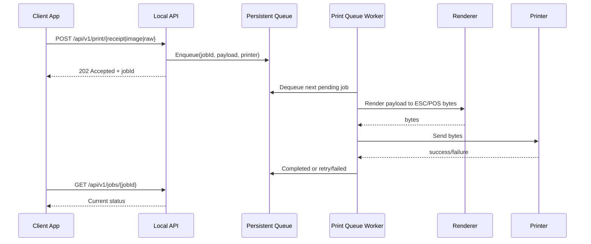
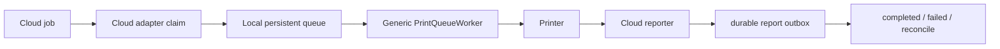

# Generic Silent Print Agent - Implementation Plan (MVP)

> **نطاق التنفيذ المعتمد:** هذا المشروع يوفّر Agent محليًا وواجهة HTTP عامة فقط. لا يتضمن Cloud client أو pairing أو credentials تخص مشروعًا بعينه. تكامل أي مستخدم مع الـ Cloud الخاص به مسؤولية ذلك المستخدم؛ نقطة الربط ودورة العمل موضحتان في `docs/INTEGRATION.md` و`samples/cloud-adapter/`. لذلك أقسام الخطة التي تقترح adapter لمزود Cloud أو تصف تكامل النظام السابق تعتبر خارج النطاق الحالي ولا تعني وجود اعتماد أو اتصال داخل الـ Agent.

> **حالة التنفيذ بعد إعادة تحديد النطاق:** مسار الطباعة المحلي والطابور الدائم والـ rendering والـ API والتثبيت والاختبارات منفذة. Task 6 أعيد تعريفه إلى starter عام قابل للتركيب من جهة المستهلك، وليس Cloud adapter مفعّلًا داخل الخدمة. تنفيذ claim/renew/report الفعلي لا يكتمل إلا بمعرفة API الذي سيختاره مستهلك المشروع.

> الهدف من الملف: خطة تنفيذ واحدة لتحويل نسخة `SilentPrintAgent` الحالية إلى **Silent Print Agent** عام يستطيع أي مشروع POS أو Web App استخدامه للطباعة الصامتة.
>
> هذه الخطة مرجع لنطاق التنفيذ والقرارات؛ راجع حالة التنفيذ أعلى الملف والـ source/tests الحالية لمعرفة ما نُفّذ فعليًا.

---

## 1. شرح الـ Feature

### الفكرة العامة

المشروع النهائي يعمل كـ Windows Service على جهاز الكاشير، ويستقبل طلبات الطباعة من أي تطبيق عبر `localhost` بدون ظهور `Print Dialog`. يجب أن يستطيع العميل إرسال إيصال منظم، أو صورة جاهزة، أو `raw ESC/POS` اختياريًا، بينما تظل Cloud polling ميزة اختيارية وليست شرطًا لتشغيل الـ Agent. التسليم إلى الطابعة هو **at-least-once**؛ لا يجوز الوعد بعدم التكرار عندما تنقطع الإشارة بعد إرسال bytes وقبل معرفة النتيجة الفعلية.

| المسار | المدخل | مسؤولية الـ Agent | النتيجة |
|---|---|---|---|
| Structured receipt | `JSON` | بناء المستند، تشكيل العربي، تحويله إلى Raster ثم `ESC/POS` | إيصال عربي مطبوع |
| Image printing | `PNG/JPEG` bytes | تحويل الصورة إلى `ESC/POS` bitmap وإرسالها | صورة مطبوعة بدون إعادة رسم |
| Raw printing | `ESC/POS` bytes | التحقق من الحجم والإعدادات ثم الإرسال | تحكم كامل للعميل المتقدم |
| Optional cloud polling | Cloud job | سحب job ووضعه في نفس الـ local queue | توافق مع أي Backend يطبق adapter |

### المكونات الرئيسية

| المكون | المكان المقترح | الوظيفة |
|---|---|---|
| Core contracts | `Core/` | DTOs وinterfaces وحالات الـ job بدون اعتماد على legacy integration أو HTTP |
| Queue and worker | `Services/Queue/` و`Workers/` | تخزين jobs، منع التكرار، التنفيذ وإعادة المحاولة |
| Rendering | `Rendering/` و`Services/Rendering/` | Structured JSON، الصور، و`raw ESC/POS` |
| Local API | `LocalApi/` | عقود HTTP العامة التي يستخدمها أي مشروع |
| Printer transports | `Services/Transports/` | Windows Spooler وTCP، مع fake transport للاختبارات |
| Optional adapters | `Adapters/` | provider-specific Cloud أو أي cloud provider بدون ربط الـ Core به |
| Documentation and samples | `docs/` و`samples/` | تشغيل، تكامل، أمثلة، وتوثيق الـ API |

### قاعدة مهمة

الـ Agent العام يجب أن يعمل بالكامل بدون `CloudPrintClient` وبدون legacy integration. الـ Cloud adapter يضيف مصدر jobs فقط، لكنه لا يملك منطق الـ rendering أو النقل أو الـ retry.

### التدفق المستهدف



---

## 2. ملخص بالأرقام

| النوع | العدد التقريبي | المطلوب |
|---|---:|---|
| Core interfaces | 8 | `IPrintJobStore`, `IPrintQueue`, `IPrintJobExecutor`, `IPayloadRenderer`, `IPrinterResolver`, `IPrintJobSource`, `ICloudReportOutbox`, `IPrinterTransport` |
| Core models | 15 | `PrintPayloadKind`, `PrintSubmission`, `PrintJob`, `PrintPayload`, `PrintResult`, `PrintFailure`, `PrinterProfile`, `PrintJobStatus`, `CloudJobReference`, `CloudReport`, `DeliveryState`, `JobLease`, `TransportSendPhase`, `TransportDeliveryState`, `TransportSendResult` |
| Hosted workers | 3 | `PrintQueueWorker`, `CloudPollingWorker` اختياري، و`CloudReportWorker` اختياري |
| Public API groups | 4 | health، printers، submit، job status |
| Renderers | 3 | structured receipt، image، raw ESC/POS |
| Printer transports | 2 + fake | Windows Spooler، TCP، `FakePrinterTransport` للاختبار |
| Test groups | 6 | contracts، queue، renderer، API، transport، manual acceptance |
| Documentation files | 4 | `README.md`، `docs/API.md`، `docs/INTEGRATION.md`، `docs/SECURITY.md` |

### الملفات المتوقعة

| النوع | المكان |
|---|---|
| Core contracts | `Core/Contracts/*.cs` |
| Core models | `Core/Models/*.cs` |
| Queue store | `Services/Queue/SqlitePrintJobStore.cs` |
| Queue worker | `Workers/PrintQueueWorker.cs` |
| Renderers | `Services/Rendering/*.cs` |
| Generic API | `LocalApi/GenericPrintEndpoints.cs` |
| provider-specific adapter | `Adapters/ProviderCloud/` |
| Configuration | `Configuration/PrintAgentOptions.cs` |
| Installer scripts | `Installer/install-service.ps1` و`Installer/uninstall-service.ps1` |
| Tests | `tests/` أو `SilentPrintAgent.Tests/` |

---

## 3. Tasks التنفيذ

| Task | الاسم | الهدف | الناتج النهائي |
|---:|---|---|---|
| 0 | مراجعة المتطلبات والكود الحالي | تثبيت الموجود والقيود | قائمة فجوات وقرارات تنفيذ |
| 1 | فصل المشروع وتثبيت الـ public package | إزالة الاعتماد الإجباري على legacy integration | مشروع قابل للتشغيل مستقلًا |
| 2 | بناء Core contracts | تثبيت عقود الـ queue والـ rendering والـ execution | Interfaces وDTOs مستقرة |
| 3 | Persistent queue وgeneric worker | ضمان عدم ضياع jobs ومنع التكرار | Worker محلي مستقل |
| 4 | Rendering pipeline | دعم JSON، الصور، و`raw ESC/POS` | ثلاث طرق طباعة موحدة |
| 5 | Generic Local API | تمكين أي مشروع من الطباعة عبر `localhost` | API موثق ومستقر |
| 6 | Optional cloud adapter | الحفاظ على polling كإضافة لا كاعتماد | provider-specific adapter قابل للتعطيل |
| 7 | Security والتثبيت والتوثيق | جعل الاستخدام آمنًا وسهلًا | README، scripts، samples، license |
| 8 | Tests وacceptance | إثبات الطباعة الصامتة والاعتمادية | Test suite وchecklist جاهز |

---

## 4. Task 0 - مراجعة المتطلبات والكود الحالي

قبل كتابة أي كود، راجع هذه القائمة:

| العنصر | الحالة الحالية | المطلوب |
|---|---|---|
| `PrintJobPollingWorker` | يعتمد مباشرة على `CloudPrintClient` | تحويله إلى adapter اختياري أو استبداله بـ `PrintQueueWorker` العام |
| `PrintJobProcessor` | يجمع التنفيذ والتبليغ للـ Cloud | فصل التنفيذ العام عن status reporting الخاص بالـ Cloud |
| `EscPosRenderer` | يرسم `PayloadJson` داخليًا إلى Raster | الإبقاء على structured path وإضافة image/raw paths |
| `LocalPrintEndpoints` | معظم المسار مربوط بـ claim من legacy integration | إضافة endpoints عامة لا تحتاج Cloud |
| `IPrinterTransport` | موجود ويدعم TCP وWindows | الحفاظ عليه وتوحيد contract الأخطاء |
| `InFlightJobTracker` | يمنع التوازي داخل process فقط | استكماله بـ persistent idempotency في الـ store |
| `appsettings.template.json` | يحتوي إعدادات legacy integration | إضافة config عامة مع Cloud disabled افتراضيًا |
| الاختبارات | جزء منها خارج النسخة المنفصلة | إضافة tests مستقلة للـ Core والـ API والـ fake printer |
| الترخيص | غير موجود | إضافة `LICENSE` بعد التأكد من ملكية الكود |

### 4.1 نتائج تدقيق الملاحظات المرفقة

| رقم الملاحظة | الحكم | التصحيح المعتمد في الخطة |
|---:|---|---|
| 1 | صحيح بالكامل | `at-least-once`، وإضافة `DeliveryUnknown` بدل الوعد بمنع duplicate بعد send uncertainty |
| 2 | صحيح بالكامل | استبدال `DequeueNextAsync` و`MarkPrintingAsync` بـ `TryClaimNextAsync` ذري مع lease |
| 3 | صحيح بالكامل | إضافة `Retrying` و`NextAttemptAt`, `StartedAt`, `LeaseExpiresAt`, `UpdatedAt` وحقول الخطأ |
| 4 | صحيح بشرط | يلزم outbox وlease/report persistence، لكن renewal وreconciliation يتطلبان دعمًا صريحًا من الـ Cloud API |
| 5 | صحيح بالكامل | اعتماد `multipart/form-data` مع `metadata` JSON و`file` bytes |
| 6 | صحيح بالكامل | اعتماد `(ClientId, JobId, RequestHash)` و`409 Conflict` عند اختلاف الطلب |
| 7 | صحيح بالكامل | جعل `X-Agent-Token` إلزاميًا للـ mutations وتوثيق rotation وpreflight |
| 8 | صحيح بالكامل | العميل يرسل `PrinterId` فقط، والـ Agent يحل profile موثوقًا من storage إداري |
| 9 | صحيح بالكامل | استخدام `ProgramData`، ACLs، service identity، واختبار الطابعة تحت نفس الحساب |
| 10 | صحيح بالكامل | توحيد `PrintJobStatus` وإضافة كل models المذكورة فعليًا في contracts |
| 11 | صحيح بالكامل | تحديد atomic cancel transition ونتيجة السباق (`Cancelled` أو `409`) |
| 12 | صحيح بالكامل | تثبيت حدود رقمية للـ body والصورة والـ raw والنسخ والـ retry والـ retention |

### قرارات مثبتة

| القرار | الأثر على التنفيذ |
|---|---|
| Local-first | التشغيل الأساسي لا ينشئ `HttpClient` للـ Cloud ولا يحتاج pairing |
| `202 Accepted` عند الإضافة | الـ API لا ينتظر وقت الطباعة؛ العميل يتابع الحالة بـ `jobId` |
| Persistent queue | jobs لا تضيع عند إعادة تشغيل الـ Agent، مع recovery للـ leases المنتهية |
| Image وstructured كلاهما مدعوم | المطور يختار بين إرسال صورة جاهزة أو ترك الـ Agent يرسم العربي |
| الـ Agent يستمع على `127.0.0.1` فقط | لا يتحول إلى خدمة طباعة مفتوحة على الشبكة |
| token إلزامي | كل endpoint يغير حالة يحتاج `X-Agent-Token`، وCORS ليس authentication |
| `raw ESC/POS` معطل افتراضيًا | يمنع عميلًا غير موثوق من إرسال أوامر طابعة مباشرة |
| delivery semantics صريحة | `Completed` تعني acknowledgement من transport فقط؛ الفشل بعد إرسال جزئي يتحول إلى `DeliveryUnknown` ولا يعاد تلقائيًا إلا حسب policy |
| Printer profiles موثوقة | العميل يرسل `PrinterId` فقط؛ لا يرسل عنوان TCP أو اسم Windows printer |
| data directory مطلق | قاعدة البيانات والأسرار تحت `ProgramData` وليس مسارًا نسبيًا يعتمد على `System32` |
| MIT للكود وOFL للخط | كل مكوّن يحتفظ برخصته الأصلية |

> [!IMPORTANT]
> لا يتم حذف مسار legacy integration الحالي قبل نقل منطق التنفيذ إلى `Core`. المطلوب هو فصل المسؤوليات أولًا، ثم تشغيل المسارين على نفس الـ queue والـ executor.

---

## 5. Task 1 - فصل المشروع وتثبيت الـ public package

### 5.1 نطاق التغيير

| التغيير | التنفيذ |
|---|---|
| Namespace واسم المشروع | تحديد هل سيظل `SilentPrintAgent` أو يتحول إلى `SilentPrintAgent` قبل إعادة تسمية الملفات؛ لا تخلط الاسمين داخل نفس الإصدار |
| provider-specific code | نقله إلى `Adapters/ProviderCloud/` وعدم حقنه في الـ default host |
| Configuration | تقسيم `AgentOptions` إلى `PrintAgentOptions` و`CloudOptions` |
| Versioning | إضافة `Version` و`ApiVersion` ثابتين وتغييرهما مع breaking changes فقط |
| Package cleanliness | عدم رفع `bin/`, `obj/`, `appsettings.json`, tokens، وlocal databases |
| Licensing | إضافة `LICENSE` للكود وترك `Resources/Fonts/OFL.txt` مع الخط |

### 5.2 الملفات المتأثرة

| الملف الحالي | الإجراء |
|---|---|
| `Program.cs` | تسجيل الـ Core والـ Local API دائمًا، وتسجيل Cloud adapter حسب `Cloud:Enabled` |
| `Models/AgentOptions.cs` | تقسيمه أو إعادة تسميته إلى config عامة |
| `Services/CloudPrintClient.cs` | نقله إلى adapter وعدم تمريره إلى `PrintJobProcessor` العام |
| `Workers/PrintJobPollingWorker.cs` | تحويله إلى `Adapters/ProviderCloud/ProviderCloudPollingWorker.cs` أو استبداله بالـ worker العام |
| `README.md` | إعادة كتابته حول الاستخدام العام، مع قسم منفصل للـ provider-specific adapter |
| `appsettings.template.json` | جعل الإعدادات الافتراضية local-first |

---

## 6. Task 2 - بناء Core contracts

### 6.1 Models الأساسية

```csharp
public enum PrintPayloadKind
{
    StructuredReceipt = 1,
    Image = 2,
    RawEscPos = 3
}

public enum PrintJobStatus
{
    Pending = 1,
    Retrying = 2,
    Printing = 3,
    Completed = 4,
    DeliveryUnknown = 5,
    Failed = 6,
    Cancelled = 7
}

public enum DeliveryState
{
    NotStarted = 1,
    Acknowledged = 2,
    Unknown = 3
}

public sealed record PrinterProfile(
    string PrinterId,
    string DisplayName,
    AgentConnectionType ConnectionType,
    string? WindowsPrinterName,
    string? Address,
    int? Port,
    byte PaperWidthMm,
    string? CodePage,
    byte DefaultCopies,
    bool CashDrawerEnabled,
    bool Enabled);

public sealed record PrintPayload(
    PrintPayloadKind Kind,
    string? Json,
    byte[]? Bytes,
    string? ContentType);

public sealed record CloudJobReference(
    string CloudJobId,
    string LeaseToken);

public sealed record PrintFailure(
    string Code,
    string Message,
    bool Retryable,
    bool DeliveryUnknown);

public sealed record PrintSubmission(
    string JobId,
    string ClientId,
    string RequestHash, // calculated by the Agent; never accepted from the public DTO
    string PrinterId,
    PrintPayload Payload,
    int MaxAttempts = 3,
    CloudJobReference? CloudReference = null);

public sealed record PrintJob(
    Guid LocalJobId,
    string JobId,
    string ClientId,
    string RequestHash,
    string PrinterId,
    PrinterProfile PrinterSnapshot,
    PrintPayload Payload,
    PrintJobStatus Status,
    int AttemptCount,
    DateTimeOffset CreatedAt,
    DateTimeOffset UpdatedAt,
    DateTimeOffset? StartedAt,
    DateTimeOffset? NextAttemptAt,
    string? ActiveLeaseId,
    DateTimeOffset? LeaseExpiresAt,
    DateTimeOffset? CompletedAt,
    string? ErrorCode,
    string? ErrorMessage,
    CloudJobReference? CloudReference,
    DeliveryState DeliveryState);

public sealed record JobLease(
    Guid LocalJobId,
    string LeaseId,
    DateTimeOffset ExpiresAt);

public sealed record CloudReport(
    Guid LocalJobId,
    string ClientId,
    string JobId,
    string CloudJobId,
    string LeaseToken,
    string EventType,
    string EventKey,
    string? ErrorCode,
    string? ErrorMessage,
    int AttemptCount,
    DateTimeOffset NextAttemptAt);

public sealed record PrintResult(
    string JobId,
    PrintJobStatus Status,
    DeliveryState DeliveryState,
    string? ErrorCode = null,
    string? ErrorMessage = null);
```

### 6.2 Interfaces

```csharp
public interface IPrintJobStore
{
    Task<PrintJob?> GetAsync(string clientId, string jobId, CancellationToken ct);
    Task<PrintJob?> GetByLocalIdAsync(Guid localJobId, CancellationToken ct);
    Task<PrintJob> EnqueueAsync(PrintSubmission submission, CancellationToken ct);
    Task<(PrintJob? Job, JobLease? Lease)> TryClaimNextAsync(
        DateTimeOffset now,
        TimeSpan leaseDuration,
        CloudReport? startedReport,
        CancellationToken ct);
    Task<bool> RenewLeaseAsync(
        Guid localJobId,
        string leaseId,
        DateTimeOffset now,
        TimeSpan extension,
        CancellationToken ct);
    Task CommitCompletedAsync(
        Guid localJobId,
        string leaseId,
        CloudReport? report,
        CancellationToken ct);
    Task CommitRetryingAsync(
        Guid localJobId,
        string leaseId,
        PrintFailure failure,
        DateTimeOffset nextAttemptAt,
        CancellationToken ct);
    Task CommitDeliveryUnknownAsync(
        Guid localJobId,
        string leaseId,
        PrintFailure failure,
        CloudReport? report,
        CancellationToken ct);
    Task CommitFailedAsync(
        Guid localJobId,
        string leaseId,
        PrintFailure failure,
        CloudReport? report,
        CancellationToken ct);
    Task<PrintJob?> TryCancelPendingAsync(
        string clientId,
        string jobId,
        CancellationToken ct);
}

public interface IPrintQueue
{
    Task SignalAsync(CancellationToken ct);
    Task WaitAsync(CancellationToken ct);
}

public interface IPrintJobExecutor
{
    Task<PrintResult> ExecuteAsync(PrintJob job, CancellationToken ct);
}

public interface IPayloadRenderer
{
    bool CanRender(PrintPayloadKind kind);
    Task<byte[]> RenderAsync(
        PrintPayload payload,
        PrinterProfile profile,
        CancellationToken ct);
}

public interface IPrinterResolver
{
    Task<PrinterProfile?> ResolveAsync(string printerId, CancellationToken ct);
    Task<IReadOnlyList<PrinterProfile>> ListAsync(CancellationToken ct);
}

public interface IPrintJobSource
{
    Task<IReadOnlyList<PrintSubmission>> FetchAsync(CancellationToken ct);
}

public interface ICloudReportOutbox
{
    Task<IReadOnlyList<CloudReport>> GetDueAsync(
        DateTimeOffset now,
        int limit,
        CancellationToken ct);
    Task MarkSentAsync(Guid localJobId, string eventKey, CancellationToken ct);
    Task MarkRetryAsync(
        Guid localJobId,
        string eventKey,
        DateTimeOffset nextAttemptAt,
        CancellationToken ct);
}
```

### 6.3 قواعد الـ contracts

| القاعدة | التنفيذ / السبب |
|---|---|
| `ClientId + JobId` idempotency key | العميل الموثق يملك namespace خاصًا للـ IDs، وإعادة نفس الطلب لا تنشئ job ثانية |
| `RequestHash` يحسبه الـ Agent | نفس الـ ID مع payload أو printer مختلف يرجع `409 Conflict` بدل إعادة استخدام الحالة بصمت |
| `PrintPayload` لا يعتمد على HTTP | يمكن استخدامه من Local API أو Cloud adapter أو tests |
| `IPrintJobExecutor` لا يعرف Cloud | نجاح الطباعة يجب أن يظل صالحًا حتى بدون Backend |
| `IPrintJobStore` هو مصدر الحالة | الـ API والـ Worker يعيدان نفس status ولا يعتمدان على memory فقط |
| `TryClaimNextAsync` عملية واحدة ذرية | تمنع race بين `dequeue` و`MarkPrinting` وتصدر lease بوقت انتهاء |
| `LocalJobId` داخلي فريد | كل update وoutbox operation تستخدمه مع `LeaseId`، فلا تعتمد على `JobId` وحده |
| `Commit*Async` transaction واحدة | تحديث job وإضافة cloud report يتمان ذريًا في SQLite عند وجود report |
| outbox insert transaction-scoped | `TryClaimNextAsync` يضيف `started` report اختياريًا، و`Commit*Async` يضيف terminal report؛ لا يوجد fire-and-forget بعد commit |
| `byte[]` لا يمرر إلى log | الصور و`raw ESC/POS` قد تحتوي بيانات حساسة أو كبيرة |

---

## 7. Task 3 - Persistent queue وgeneric worker

### 7.1 التخزين

استخدم `SQLite` محلية في `ProgramData` عبر `Microsoft.Data.Sqlite` أو طبقة persistence مكافئة. لا تستخدم `data/print-agent.db` كمسار نسبي؛ لأن Windows Service قد يفسره تحت `System32`.

| العنصر | القاعدة |
|---|---|
| جدول `PrintJobs` | يخزن `LocalJobId`، `ClientId`, `JobId`, `RequestHash`, `PrinterId`, profile snapshot، payload، status، attempts، timestamps، lease، وerror آخر |
| Unique key | `(ClientId, JobId)` فريد؛ نفس hash يعيد الحالة، وhash مختلف يرجع `409 Conflict` |
| claim | `TryClaimNextAsync` transaction واحدة ذرية تفحص `Pending/Retrying` و`NextAttemptAt`، وتكتب `Printing`, `StartedAt`, `LeaseExpiresAt`, و`ActiveLeaseId`، وتضيف `startedReport` إن وجد |
| lease renewal | `RenewLeaseAsync` يحدث `LeaseExpiresAt` فقط إذا تطابق `LocalJobId + ActiveLeaseId`؛ worker يطلب التجديد كل `LeaseDuration / 3` |
| crash recovery | job ذات `Printing` و`LeaseExpiresAt < now` تتحول إلى `DeliveryUnknown`، ولا تعاد تلقائيًا إلا حسب policy صريحة |
| retention | حذف `Completed` و`Failed` بعد مدد config، مع الاحتفاظ بـ `DeliveryUnknown` للمراجعة مدة أطول |
| Cloud outbox | جدول `CloudReports` يخزن `LocalJobId`, `EventKey`, status، ومحاولات كل report حتى لا يضيع `completed` بعد crash؛ unique key هو `(LocalJobId, EventKey)` |
| atomic outcome | `CommitCompletedAsync`/`CommitDeliveryUnknownAsync` يحدثان `PrintJobs` ويضيفان `CloudReports` في SQLite transaction واحدة |

### 7.1.1 نموذج الـ lease والـ delivery uncertainty

| الحالة | المعنى | الإجراء |
|---|---|---|
| `Retrying` | لم يبدأ إرسال bytes أو فشل قبل الإرسال | retry بعد `NextAttemptAt` |
| `Printing` | worker يملك lease وما زال يعمل | لا يسمح بـ claim آخر لنفس job |
| `Completed` + `Acknowledged` | transport أعاد نجاحًا واضحًا | لا retry |
| `DeliveryUnknown` + `Unknown` | قد تكون الطابعة استلمت بعض أو كل bytes | لا retry تلقائيًا إلا إذا اختار المستخدم policy لذلك |
| `Failed` | فشل معروف قبل التسليم أو بعد تجاوز policy | يظهر السبب ولا يعاد بلا نهاية |

> [!WARNING]
> لا يمكن للـ Agent إثبات عدم طباعة الورقة بعد انقطاع TCP أو Windows Spooler عقب إرسال bytes. لذلك يجب أن تعرض الـ API `DeliveryUnknown` وأن توثق أن retry في هذه الحالة قد يسبب duplicate receipt.

### 7.2 `PrintQueueWorker`

| المسؤولية | التنفيذ |
|---|---|
| الانتظار | `WaitAsync` على signal مع polling احتياطي كل فترة |
| التنفيذ | يأخذ job واحدة أو عددًا محدودًا حسب `MaxConcurrency` |
| claim | يستخدم lease ذريًا؛ لا توجد خطوة منفصلة `DequeueNextAsync` ثم `MarkPrintingAsync` |
| منع التكرار | يعتمد على `(ClientId, JobId, RequestHash)` وعلى lease في store، وليس على `InFlightJobTracker` فقط |
| lease heartbeat | يشغل renewal loop لكل job طويلة، ويوقف البدء إذا فشل التجديد قبل send |
| retry | exponential backoff بالأرقام المحددة في config، فقط للفشل المعروف قبل التسليم |
| unknown delivery | يحول failure بعد الإرسال الجزئي إلى `DeliveryUnknown` ولا يقرر retry تلقائيًا |
| lease renewal failure | إذا فشل التجديد قبل بدء الإرسال، لا يبدأ send ويظهر failure قابل للمراجعة؛ إذا فشل بعد بدء الإرسال، النتيجة `DeliveryUnknown` |
| الإلغاء | لا يقطع إرسال bytes للطابعة بسبب timeout قصير للـ HTTP request |
| logging | يسجل `jobId`, `printerId`, duration، والـ error code بدون payload |

> [!IMPORTANT]
> يجب عدم اعتبار وصول `202 Accepted` نجاحًا نهائيًا. النجاح الحقيقي هو `Completed` بعد أن تنتهي عملية الإرسال للطابعة.

### 7.3 فصل `PrintJobProcessor`

| الجزء الحالي | الشكل المستهدف |
|---|---|
| `ExecuteCoreAsync` | ينتقل إلى `IPrintJobExecutor` العام |
| `ReportStartedAsync` و`ReportCompletedAsync` | ينتقلان إلى `ProviderCloudJobReporter` و`ICloudReportOutbox` اختياريين |
| `CloudJobId` و`LeaseToken` | يحفظان داخل `PrintJob`، ولا يبقيان في memory أو في DTO لحظي فقط |
| outcome + report | `CommitCompletedAsync` و`CommitDeliveryUnknownAsync` يكتبان الحالة وoutbox report في transaction واحدة |
| `CashDrawerService` | يظل جزءًا من executor لأنه مرتبط بالـ printer profile لا بالـ Cloud |
| `InFlightJobTracker` | يظل optimization داخل process، وليس مصدر idempotency الأساسي |

---

## 8. Task 4 - Rendering pipeline

### 8.1 Structured receipt renderer

| المطلوب | التنفيذ |
|---|---|
| JSON إلى document | الحفاظ على `ReceiptDocumentBuilder` بعد إزالة أي model خاص بالـ legacy integration |
| عربي وRTL | الاستمرار باستخدام `SkiaSharp`, `SkiaSharp.HarfBuzz`, وNoto Naskh Arabic |
| document إلى bitmap | الحفاظ على `ReceiptRasterizer` مع limits للعرض والارتفاع |
| bitmap إلى ESC/POS | الحفاظ على `EscPosRasterEncoder` وأوامر cut/feed الحالية |
| schema | توثيق schema عام للإيصال في `docs/RECEIPT-SCHEMA.md` |

### 8.2 Image renderer

إضافة `ImagePayloadRenderer`:

| الحالة | النتيجة |
|---|---|
| `PNG` أو `JPEG` صالح | decode ثم resize/threshold حسب paper width ثم encode إلى ESC/POS raster |
| صورة أعرض من الورق | resize بنسبة ثابتة بدون stretching |
| صورة أكبر من حد الذاكرة | `PayloadTooLarge` بدون محاولة rendering |
| أبعاد أكبر من `2048x16000` pixels | `ImageDimensionsExceeded` قبل إنشاء bitmap كبير |
| format غير مدعوم | `UnsupportedImageFormat` |
| صورة فارغة أو تالفة | `InvalidPayload` بدون إرسال bytes للطابعة |

### 8.3 Raw ESC/POS renderer

| القاعدة | التنفيذ / السبب |
|---|---|
| disabled افتراضيًا | `raw ESC/POS` يستطيع تنفيذ أوامر drawer/cut مباشرة |
| حد أقصى للحجم | منع استهلاك الذاكرة أو إرسال payload غير محدود |
| لا يضاف cut تلقائيًا | العميل هو المسؤول عن command sequence في هذا المسار |
| لا يستخدم مع browser غير موثوق | يفتح فقط بعد `AllowRawEscPos = true` وlocal authentication |

### 8.4 التوافق مع المسار الحالي

يجب أن تبقى methods الحالية أو adapters مؤقتة حتى تمر كل الاختبارات:

```csharp
Task<byte[]> RenderReceiptAsync(
    string payloadJson,
    PrinterProfile profile,
    CancellationToken ct);

Task<byte[]> RenderImageAsync(
    byte[] imageBytes,
    string contentType,
    PrinterProfile profile,
    CancellationToken ct);

Task<byte[]> RenderRawAsync(
    byte[] rawEscPos,
    PrinterProfile profile,
    CancellationToken ct);
```

### 8.5 Transport delivery contract

لا يكفي أن يرجع transport `Exception` فقط؛ الـ executor يحتاج معرفة هل بدأ إرسال bytes أم لا.

```csharp
public enum TransportSendPhase
{
    NotStarted = 1,
    Connecting = 2,
    Sending = 3,
    SendCompleted = 4,
    AcceptedBySpooler = 5
}

public enum TransportDeliveryState
{
    NotAttempted = 1,
    Acknowledged = 2,
    Uncertain = 3
}

public sealed record TransportSendResult(
    TransportDeliveryState DeliveryState,
    TransportSendPhase Phase,
    long BytesWritten,
    string? ErrorCode = null,
    string? ErrorMessage = null);

public interface IPrinterTransport
{
    Task<TransportSendResult> SendAsync(
        PrinterProfile profile,
        ReadOnlyMemory<byte> data,
        CancellationToken ct);
}

public sealed class PrinterException(
    string errorCode,
    string message,
    TransportSendPhase phase,
    bool deliveryUncertain,
    Exception? inner = null) : Exception(message, inner)
{
    public string ErrorCode { get; } = errorCode;
    public TransportSendPhase Phase { get; } = phase;
    public bool DeliveryUncertain { get; } = deliveryUncertain;
}
```

| الحالة | تفسيرها في الـ executor |
|---|---|
| `NotAttempted` مع failure | retry آمن حسب `MaxAttempts` |
| `Connecting` أو `Sending` مع failure | `DeliveryUnknown`؛ قد تكون bytes وصلت |
| `SendCompleted`/`AcceptedBySpooler` | transport قبل البيانات؛ لا يعني بالضرورة أن الورق خرج فعليًا |
| cancellation بعد بدء الإرسال | `DeliveryUnknown`، ولا يلغى job كأنها لم تبدأ |

إذا احتاج transport إلى throw، يجب أن يحمل `PrinterException.DeliveryUncertain` و`PrinterException.Phase`، أو يحول إلى `TransportSendResult` قبل وصوله للـ executor. لا يسمح للـ retry policy باستنتاج الحالة من نص exception.

---

## 9. Task 5 - Generic Local API

### 9.1 Endpoints

| Method | Endpoint | الوظيفة |
|---|---|---|
| `GET` | `/health` | حالة الـ Agent والـ queue والإصدار |
| `GET` | `/api/v1/printers` | عرض printer profiles المتاحة |
| `POST` | `/api/v1/print/receipt` | استقبال structured receipt JSON |
| `POST` | `/api/v1/print/image` | استقبال `multipart/form-data` فيه `metadata` و`file` |
| `POST` | `/api/v1/print/raw` | استقبال `multipart/form-data` فيه `metadata` و`file` عند تفعيله |
| `GET` | `/api/v1/jobs/{jobId}` | متابعة حالة job |
| `POST` | `/api/v1/jobs/{jobId}/cancel` | محاولة إلغاء job ذات `Pending/Retrying` فقط |

### 9.2 DTOs للـ API

```csharp
public sealed record ReceiptPrintRequest(
    string JobId,
    string PrinterId,
    JsonElement Receipt,
    byte? Copies,
    bool? OpenCashDrawer);

public sealed record BinaryPrintMetadata(
    string JobId,
    string PrinterId,
    byte? Copies,
    bool? OpenCashDrawer);

public sealed record PrintJobResponse(
    string JobId,
    string Status,
    string StatusUrl,
    string? ErrorCode = null,
    string? ErrorMessage = null);
```

### 9.2.1 عقد image/raw الدقيق

يستخدم endpoint `image` و`raw` نفس عقد `multipart/form-data`:

| Part | النوع | القاعدة |
|---|---|---|
| `metadata` | `application/json` | يحتوي `JobId`, `PrinterId`, `Copies`, و`OpenCashDrawer` |
| `file` | `image/png`, `image/jpeg` أو `application/octet-stream` | bytes الفعلية، بدون Base64، مع حد حجم واضح |

لا تقرأ الـ API `PrinterProfile` أو عنوان TCP من body؛ `PrinterId` فقط يأتي من العميل، والـ profile يُحل من `IPrinterResolver`.

### 9.3 HTTP rules

| القاعدة | التنفيذ / السبب |
|---|---|
| submit يرجع `202` | لأن الطباعة asynchronous |
| duplicate بنفس `(ClientId, JobId, RequestHash)` | يرجع نفس الحالة بدون enqueue أو إرسال جديد |
| نفس `(ClientId, JobId)` مع hash مختلف | يرجع `409 Conflict` ولا يغير الـ job الموجودة |
| `JobId` format | من 1 إلى 128 حرفًا من `[A-Za-z0-9._:-]`، والـ `ClientId` يأتي من token وليس من body |
| payload validation قبل enqueue | رفض الطلب قبل إنشاء job غير صالح |
| `GET status` لا يعيد payload | تقليل تسريب بيانات الإيصال |
| errors في `ProblemDetails` | نفس شكل الأخطاء لكل clients |
| HTTP cancellation لا يلغي job | browser timeout لا يجب أن يقطع ورقة بدأت بالفعل |
| `127.0.0.1` فقط | الطباعة ليست remote print server في الـ MVP |
| mutation endpoints تحتاج `X-Agent-Token` | CORS لا يعتبر authentication، والتوكن يحدد `ClientId` والصلاحيات |
| preflight | `Access-Control-Allow-Headers` يتضمن `Content-Type, X-Agent-Token` |
| cancel أثناء `Printing` | يرجع `409 Conflict` ولا يحاول قتل send جارٍ |
| cancel أثناء `Pending/Retrying` | transition ذري إلى `Cancelled`؛ worker لا يستطيع claim بعد ذلك |

### 9.3.1 حساب `RequestHash` وقراءة الحالة

الـ `RequestHash` لا يأتي من client. الـ Agent يحسبه بعد parsing وvalidation وقبل `EnqueueAsync` باستخدام `SHA-256` على canonical envelope ثابت:

```text
version
payload-kind
content-type
printer-id
normalized-copies
normalized-open-cash-drawer
canonical-payload-bytes
```

| نوع payload | الجزء المستخدم في hash |
|---|---|
| Structured receipt | `JSON` canonicalized بترتيب خصائص ثابت وUTF-8 بدون whitespace زائد |
| Image | bytes الأصلية بعد validation، مع `Content-Type` |
| Raw ESC/POS | bytes الأصلية مع `Content-Type = application/octet-stream` |

لا يدخل `JobId` أو `ClientId` داخل payload hash؛ يتم تخزينهما كـ identity columns منفصلة. عند وجود `(ClientId, JobId)` سابق، يقارن الـ Agent hash المحسوب فقط: نفس hash يعيد الحالة، وأي اختلاف يرجع `409 Conflict`.

القيم `normalized-copies` و`normalized-open-cash-drawer` تُحسب بعد تطبيق defaults والـ profile limits، حتى لا تنتج قيمتان مختلفتان لنفس الطلب المنطقي.

كل من `GET /api/v1/jobs/{jobId}` و`POST /api/v1/jobs/{jobId}/cancel` يحتاج `X-Agent-Token`. الـ Agent يستخرج `ClientId` من token ثم ينفذ `GetAsync(ClientId, JobId, ct)`؛ لا يجوز وجود status endpoint مفتوح أو query يعتمد على `JobId` وحده.

### 9.4 أمثلة integration المطلوبة

إضافة أمثلة قابلة للنسخ في `samples/`:

| المثال | الملف |
|---|---|
| Browser `fetch` لصورة | `samples/javascript/print-image.js` |
| Browser `fetch` لإيصال JSON | `samples/javascript/print-receipt.js` |
| .NET client | `samples/dotnet/Program.cs` |
| Python client | `samples/python/print.py` |
| `curl` commands | `samples/curl/README.md` |

### 9.5 Printer profiles contract

الـ public API لا يستقبل `Address`, `Port`, أو `WindowsPrinterName`. هذه القيم تأتي فقط من profile موثوق يقرأه الـ Agent.

| الحقل | النوع | القاعدة |
|---|---|---|
| `PrinterId` | `string` | ثابت، من 1 إلى 64 حرفًا، وفريد داخل الـ Agent |
| `DisplayName` | `string` | اسم للعرض فقط، لا يستخدم كعنوان اتصال |
| `ConnectionType` | `enum` | `WindowsPrinter` أو `NetworkEscPos` في الـ MVP |
| `WindowsPrinterName` | `string?` | مطلوب فقط مع Windows Spooler |
| `Address` | `string?` | عنوان IP/hostname مع validation، لا يأتي من client request |
| `Port` | `int?` | بين `1` و`65535`، والافتراضي `9100` لـ TCP |
| `PaperWidthMm` | `byte` | القيم المسموحة `58` أو `80` فقط في الإصدار الأول |
| `DefaultCopies` | `byte` | من `1` إلى `10` |
| `Enabled` | `bool` | profile disabled لا يقبل jobs جديدة |

تخزن profiles في `printers.json` تحت data directory مع ACLs، أو في جدول `PrinterProfiles` داخل SQLite. لا يوجد endpoint public لتعديلها في MVP؛ التعديل يتم من ملف/CLI إداري محلي، ثم يعاد تحميلها بطريقة atomic.

---

## 10. Task 6 - Optional cloud adapter

### المسؤولية

الـ adapter يحول cloud jobs إلى `PrintSubmission` ويدفعها إلى نفس `IPrintJobStore`. لا ينفذ rendering أو transport بنفسه.

| المكون | المطلوب |
|---|---|
| `IPrintJobSource` | contract عام لجلب jobs |
| `ProviderCloudPrintJobSource` | ينقل منطق `CloudPrintClient.GetNextJobAsync` |
| `ProviderCloudJobReporter` | يرسل started/completed/failed من خلال outbox durable |
| `CloudPollingWorker` | heartbeat، fetch، enqueue، ثم polling interval |
| `CloudReportWorker` | يعيد إرسال reports المؤجلة مع backoff ولا يرسل duplicate event |
| config | `Cloud:Enabled = false` افتراضيًا |

### ترتيب الحالة في cloud mode



### قواعد

| القاعدة | السبب |
|---|---|
| Cloud لا يكون required dependency | أي مستخدم يريد local API فقط يجب أن يشغل البرنامج بدون backend |
| حفظ `CloudJobId` و`LeaseToken` | crash recovery يحتاج الربط بين local job وcloud lease |
| report بعد نتيجة الطابعة | لا نبلغ Cloud بالنجاح قبل خروج bytes من transport، لكن report نفسه يدخل outbox قبل إرساله |
| report retry | فشل الشبكة لا يسقط event؛ يعاد من `CloudReportWorker` مع idempotency key |
| claim failure لا ينشئ local job | حتى لا تظهر job محلية غير مملوكة للـ Agent |
| lease renewal | يجب أن يوفر الـ Cloud API endpoint لتجديد lease أثناء الطباعة الطويلة؛ إذا لم يوجد، لا ندعي ضمان منع duplicate |
| crash بعد الطباعة وقبل report | local job تصبح `Completed` مع report pending؛ لا تعاد للطباعة تلقائيًا |
| delivery unknown | إذا انتهى lease أو فشل report بعد إرسال bytes، الحالة تحتاج reconciliation/قرار operator قبل retry |

### 10.1 متطلبات Cloud API قبل تفعيل adapter

| المتطلب | الغرض |
|---|---|
| `leaseId` أو `LeaseToken` ثابت | ربط كل event بنفس claim |
| idempotent `started/completed/failed` | إعادة نفس event لا تعيد job إلى queue ولا تسبب duplicate |
| `POST /jobs/{id}/renew` أو equivalent | تمديد lease أثناء rendering/printing |
| `GET /jobs/{id}/reconcile` أو equivalent | معرفة هل cloud يعتبر job completed بعد crash أو timeout |
| event id أو `(CloudJobId, EventType, LeaseToken)` key | منع duplicate reports في outbox |

إذا لم يدعم الـ Backend هذه العمليات، يكون الـ adapter **best effort** فقط، ويجب عرض `DeliveryUnknown` وعدم تشغيل auto-retry بعد send uncertainty.

---

## 11. Task 7 - Security والتثبيت والتوثيق

### 11.1 Security

| النقطة | التنفيذ |
|---|---|
| Binding | `IPAddress.Loopback` فقط في default config |
| CORS | allowlist صريحة، وليس `*` |
| Local token | إلزامي لكل endpoint يغير حالة، وليس optional؛ token يولد أثناء install ويحفظ في secret file بـ ACLs |
| Token rotation | أمر CLI أو installer command يغير token، يبطل القديم، ولا يظهر في logs |
| CORS headers | preflight يسمح صراحة بـ `Content-Type, X-Agent-Token` فقط |
| Size limits | القيم الرقمية محددة في `PrintAgentOptions` ولا يملك client تجاوزها |
| Logs | لا تسجل token أو payload أو صورة |
| Printer names | validation ضد path/command injection في Windows printer selection |
| Raw mode | disabled افتراضيًا مع warning واضح في health/config |

### 11.1.1 Default limits والسياسات الرقمية

| الإعداد | القيمة الافتراضية | ملاحظة |
|---|---:|---|
| `MaxReceiptJsonBytes` | `262144` | `256 KiB` |
| `MaxImageBytes` | `8388608` | `8 MiB` |
| `MaxRawEscPosBytes` | `1048576` | `1 MiB` |
| `MaxImageWidthPx` | `2048` | يرفض الأبعاد الأكبر قبل decode كامل |
| `MaxImageHeightPx` | `16000` | يمنع raster ضخمًا |
| `MaxCopies` | `10` | أي قيمة أعلى ترجع `422` |
| `MaxAttempts` | `3` | للفشل المعروف قبل التسليم فقط |
| `LeaseDurationSeconds` | `120` | يجب أن يغطي rendering والإرسال المعتاد |
| `RetryInitialDelaySeconds` | `2` | exponential backoff |
| `RetryMaxDelaySeconds` | `60` | سقف التأخير |
| `CompletedRetentionDays` | `7` | قابل للتعديل إداريًا |
| `DeliveryUnknownRetentionDays` | `30` | أطول للمراجعة قبل الأرشفة |

### 11.2 Windows Service packaging

إضافة:

| الملف | الوظيفة |
|---|---|
| `Installer/install-service.ps1` | publish، إنشاء service، تحديد data directory تحت `C:\ProgramData\SilentPrintAgent`، إنشاء token، وضبط حساب الخدمة |
| `Installer/uninstall-service.ps1` | إيقاف وحذف service بدون حذف data تلقائيًا |
| `Installer/appsettings.production.template.json` | config إنتاجية بدون secrets |
| `docs/INSTALL-WINDOWS.md` | خطوات التثبيت، firewall، printers، logs، ACLs، وحساب الخدمة |

### 11.2.1 Windows Service identity وdata directory

| النقطة | القرار التنفيذي |
|---|---|
| data path | default هو `%ProgramData%\SilentPrintAgent`، ويُمرر للـ host كمسار مطلق |
| SQLite وsecrets | تحت `data/` و`secrets/` داخل المسار السابق مع ACLs لحساب الخدمة فقط |
| service identity | installer يطلب `-ServiceAccount`؛ `LocalSystem` مسموح فقط عندما تكون الطابعات system-wide ومختبرة |
| user/network printers | إذا كانت الطابعة أو network share مرتبطة بمستخدم، يجب تشغيل الخدمة بحساب مخصص يملكها |
| validation | installer يشغل health/printer visibility check تحت نفس حساب الخدمة قبل الإكمال |
| logs | تحت `%ProgramData%\SilentPrintAgent\logs`، وليس current working directory |

### 11.3 Documentation and licensing

| الملف | المحتوى |
|---|---|
| `README.md` | quick start عام، بدون افتراض legacy integration |
| `docs/API.md` | كل endpoints وrequest/response وstatus codes |
| `docs/INTEGRATION.md` | دمج JavaScript و.NET وPython |
| `docs/SECURITY.md` | localhost، CORS، token، raw mode، وحدود الثقة |
| `docs/RECEIPT-SCHEMA.md` | schema structured receipt ودعم العربي |
| `LICENSE` | MIT للكود بعد تأكيد الملكية |
| `NOTICE` أو `THIRD-PARTY-NOTICES.md` | تراخيص dependencies، مع إبقاء `Resources/Fonts/OFL.txt` |

---

## 12. Task 8 - Tests وacceptance

### 12.1 Unit Tests

| الاختبار | المتوقع |
|---|---|
| enqueue جديد | job تدخل `Pending` مرة واحدة |
| duplicate بنفس `(ClientId, JobId, RequestHash)` | لا تُنشأ job ثانية، وتُعاد الحالة الأصلية |
| نفس ID مع payload/printer مختلف | `409 Conflict` و`Times.Never` على transport |
| dequeue concurrent | نفس job لا تخرج لعمليتين |
| claim concurrent | `TryClaimNextAsync` تمنح lease واحدة فقط |
| lease renewal | lease تطول فقط مع `LocalJobId + ActiveLeaseId` الصحيح |
| lease renewal failure قبل send | لا يبدأ transport، وتظهر نتيجة قابلة للمراجعة |
| lease renewal failure أثناء send | النتيجة `DeliveryUnknown` ولا يحدث reclaim ثانٍ |
| crash recovery | `Printing` ذات lease منتهية تصبح `DeliveryUnknown` ولا تعاد تلقائيًا |
| cloud report outbox | `completed` وjob state يكتبان في transaction واحدة، ويستمران بعد restart |
| structured Arabic receipt | ينتج bytes raster غير فارغة بدون exception |
| image PNG/JPEG | ينجح rendering حسب paper width |
| invalid image | `InvalidPayload` ولا يتم استدعاء transport |
| raw disabled | الطلب يرفض بـ `403` أو `422` حسب contract |
| failure قبل إرسال bytes | `Retrying` مع backoff ولا يضيع job |
| failure بعد إرسال bytes | `DeliveryUnknown` ولا auto-retry افتراضيًا |
| max attempts | تتحول job إلى `Failed` ولا تعاد بلا نهاية |
| cancellation | لا يقطع job عند إلغاء HTTP request |
| cancel race | `Pending/Retrying` تتحول `Cancelled`، و`Printing` ترجع `409` |
| drawer flag | يرسل drawer command مرة واحدة فقط |
| transport phase | failure قبل `Sending` يختلف عن failure بعد `Sending` |
| request hash | يحسبه Agent من canonical payload؛ قيمة client المرسلة لا تقبل |

### 12.2 Integration Tests

| السيناريو | التحقق |
|---|---|
| `POST /api/v1/print/receipt` | يرجع `202` ثم `Completed` مع fake transport |
| `POST /api/v1/print/image` multipart | الصورة تتحول إلى ESC/POS وتصل للـ fake printer |
| duplicate نفس الطلب | الورقة تُرسل مرة واحدة |
| duplicate مختلف | يرجع `409` ولا يتم إرسال أي bytes إضافية |
| printer offline قبل send | status يصبح `Retrying` ثم `Failed` حسب policy |
| printer uncertain بعد send | status يصبح `DeliveryUnknown` ولا يعاد افتراضيًا |
| process restart | pending job تستمر بعد إعادة التشغيل |
| CORS origin غير مسموح | يرجع `403` ولا يضيف job |
| token missing/invalid | يرجع `401` ولا يغير queue |
| status cross-client | token لعميل A لا يقرأ job لعميل B |
| profile tampering | client لا يستطيع تغيير address أو Windows printer name |
| raw mode off | لا يمرر raw bytes |
| cloud disabled | البرنامج يبدأ بدون cloud URL صحيح |
| provider-specific adapter enabled | job cloud تدخل نفس local queue ولا يوجد executor مختلف |

### 12.3 Manual Acceptance Scenarios

| السيناريو | الخطوات | النتيجة |
|---|---|---|
| طباعة إيصال عربي | شغل Agent، أرسل structured receipt | العربي يظهر صحيحًا بدون dialog |
| طباعة صورة جاهزة | أرسل PNG من browser أو `curl` | الصورة تطبع بنفس الشكل تقريبًا |
| طابعة Windows | اختر Windows printer | الورق يخرج عبر RAW spooler |
| طابعة TCP | اضبط address وport `9100` | bytes تصل للطابعة الشبكية |
| انقطاع الطابعة قبل الإرسال | افصلها قبل التنفيذ | job تعاد حسب retry |
| انقطاع الطابعة بعد بدء الإرسال | افصلها أثناء الإرسال | تظهر `DeliveryUnknown` ويطلب القرار قبل retry |
| إغلاق Agent أثناء job | أوقف الخدمة ثم شغلها | job غير المكتملة تعالج حسب recovery policy |
| duplicate browser retry | أعد إرسال نفس `ClientId + JobId + RequestHash` | لا يخرج إيصال ثانٍ |
| ID reuse ببيانات مختلفة | أعد نفس ID مع payload مختلف | يرجع `409 Conflict` |
| cancel race | اضغط cancel أثناء `Printing` | `409` ولا يتم قتل send الجاري |
| Cloud off | أوقف cloud config | local API يظل يعمل طبيعيًا |

---

## 13. قواعد Business مهمة

### 13.1 قواعد الطباعة

| القاعدة | الشرح |
|---|---|
| لا يوجد Print Dialog | كل المسارات ترسل bytes مباشرة إلى transport |
| النجاح بعد transport فقط | `Accepted` ليس `Completed` |
| delivery semantics `at-least-once` | لا نعد بمنع duplicate عند `DeliveryUnknown` بعد إرسال جزئي |
| كل job لها `(ClientId, JobId, RequestHash)` | نفس الطلب لا ينتج إرسالًا ثانيًا، والطلب المختلف بنفس ID يرفض |
| عدد النسخ يطبق في executor | لا يكرر العميل HTTP request للحصول على نسخ متعددة |
| drawer ليس printer منفصلًا | يفتح على target المحدد مرة واحدة |

### 13.2 قواعد العربي والصور

| القاعدة | الشرح |
|---|---|
| structured Arabic يرسم كصورة | لأن code pages الطابعة لا تضمن shaping وRTL |
| الصورة الجاهزة لا يعاد تشكيل نصها | الـ Agent يطبع bitmap فقط |
| raw لا يمر عبر renderer | العميل المتقدم يملك كامل sequence |
| fallback واضح | لو فشل renderer يرجع error ولا يرسل ورقة ناقصة |

### 13.3 قواعد الثقة والخصوصية

| القاعدة | الشرح |
|---|---|
| local endpoint ليس public API | لا يتم binding على network interfaces في MVP |
| CORS ليس authentication | `X-Agent-Token` إلزامي للـ mutations، ولا نعتمد على Origin وحده |
| client لا يختار transport endpoint | يرسل `PrinterId` فقط؛ profile الموثوق يحدد address أو Windows printer |
| payload لا يدخل logs | الإيصالات قد تحتوي أسعارًا أو بيانات عملاء |
| data retention configurable | لا نحتفظ بالإيصالات أكثر من المطلوب للتشغيل |

---

## 14. ترتيب التنفيذ المقترح

### جدول التنفيذ

| المرحلة | الشغل | الهدف |
|---|---|---|
| 1 | Task 0 + تثبيت الاسم والـ license policy | منع إعادة العمل ومشاكل الملكية |
| 2 | Core models وinterfaces | تثبيت الحدود بين API والـ worker والـ adapters |
| 3 | SQLite store وqueue worker | تشغيل local jobs بدون Cloud |
| 4 | فصل executor عن cloud reporting | جعل الطباعة reusable |
| 5 | image renderer + structured renderer contract | دعم صورتك الجاهزة مع الحفاظ على العربي داخل Agent |
| 6 | Generic Local API | تمكين أي مشروع من التكامل |
| 7 | tests وfake printer | إثبات السلوك قبل الأجهزة الحقيقية |
| 8 | optional provider-specific adapter | الحفاظ على التوافق بدون تلويث Core |
| 9 | installer/docs/samples | جعل المشروع قابلًا للتبني من مطور خارجي |

### ترتيب أدق

| الترتيب | المهمة |
|---:|---|
| 1 | أضف Core models والـ interfaces بدون تغيير behavior الحالي |
| 2 | نفذ store بـ SQLite واختبر idempotency |
| 3 | انقل `ExecuteCoreAsync` إلى executor عام |
| 4 | اجعل `EscPosRenderer` يطبق structured/image/raw contracts |
| 5 | أنشئ `PrintQueueWorker` وشغل local receipt end-to-end |
| 6 | أضف endpoints العامة وstatus polling |
| 7 | انقل Cloud polling إلى adapter اختياري |
| 8 | أضف security limits وinstaller |
| 9 | شغل unit/integration/manual acceptance ثم حدّث README |

---

## 15. Test Plan

### Unit Tests

| الفئة | الحد الأدنى |
|---|---|
| Queue store | enqueue، duplicate، dequeue، recovery، retention |
| Executor | success، retryable failure، permanent failure، drawer |
| Structured renderer | Arabic، RTL، paper widths، empty payload |
| Image renderer | PNG، JPEG، oversized، corrupt، width scaling |
| API validation | missing fields، invalid printer، body limits، raw disabled |
| Cloud adapter | source mapping، report after success، claim failure |

### Negative and Boundary Tests

| الحالة | المتوقع |
|---|---|
| `JobId` فارغ | `400` ولا يوجد row |
| `Copies = 0` | يرفض أو يستخدم default موثق، لكن لا يطبع صفر مرات بصمت |
| body أكبر من limit | `413 Payload Too Large` |
| paper width غير مدعوم | `422` برسالة واضحة |
| printer غير موجود | `PrinterNotConfigured` بدون transport call |
| error بعد إرسال جزئي | status failure واضح ولا يفترض أن retry آمن إلا حسب transport policy |
| نفس job أثناء `Printing` | يعيد الحالة الحالية ولا يبدأ إرسالًا ثانيًا |

### Manual Acceptance Scenarios

الـ scenarios المذكورة في Task 8 تصبح gate قبل إصدار `v1.0.0`، ويجب تنفيذها على طابعة Windows حقيقية وطابعة TCP حقيقية بالإضافة إلى fake transport.

---

## 16. Out of Scope

| خارج النطاق | السبب |
|---|---|
| Linux/macOS printer service | الـ MVP يستهدف Windows كما يتطلب `Windows Spooler` |
| Remote printing عبر الإنترنت | يحتاج authentication وfirewall وmulti-tenant policy مختلفة |
| PDF rendering | ليس مطلوبًا لمسار thermal receipt الأول |
| دعم كل موديلات ESC/POS | اختلافات الشركات تحتاج compatibility matrix لاحقة |
| Dashboard لإدارة الطابعات | الـ MVP يقدم API وconfig فقط |
| Multi-tenant cloud backend | الـ Cloud adapter الحالي reference وليس SaaS platform |
| ضمان transactional delivery بعد انقطاع كهرباء أثناء الإرسال | يعتمد على hardware؛ نوثق حدود retry بدل ادعاء ضمان غير ممكن |

---

## 17. Assumptions

| الافتراض | السبب |
|---|---|
| التطبيق العميل يعمل على نفس جهاز الكاشير أو يستطيع الوصول إلى `127.0.0.1` | هذا أساس silent printing الآمن |
| كل printer profile معروفة مسبقًا | الـ Agent لا يبحث عن كل طابعات الشبكة تلقائيًا في MVP |
| المستخدم لديه صلاحية تثبيت Windows Service | مطلوبة للتشغيل الدائم |
| الكود المراد نشره مملوك أو مصرح بنشره | شرط أساسي لإضافة MIT بشكل صحيح |
| الخط العربي يمكن توزيعه مع `OFL.txt` | الملف موجود ضمن النسخة الحالية |
| الـ client يحتفظ بـ `JobId` ويعيد نفس payload عند retry | مطلوب لتفعيل idempotency؛ تغيير payload بنفس ID خطأ |
| token يحدد `ClientId` | يمنع عميلًا محليًا من اختطاف job تخص client آخر |
| profiles يكتبها admin فقط | client لا يملك حق تغيير عنوان الطابعة أو transport |
| طباعة غير مؤكدة ممكنة | hardware/transport لا يقدم two-phase commit بعد انقطاع الاتصال |
| Cloud backend يدعم lease/report idempotency عند تفعيل adapter | بدون ذلك يكون cloud mode best effort فقط |
| default mode لا يحتاج Cloud | يجعل المشروع قابلًا للاستخدام من أي stack |

---

## 18. Checkpoint قبل اعتبار المرحلة مكتملة

| الشرط | لازم يحصل |
|---|---|
| مشروع جديد يستطيع تشغيل Agent بدون legacy integration أو Cloud | نعم |
| JavaScript يستطيع إرسال صورة والطباعة بدون dialog | نعم |
| مشروع آخر يستطيع إرسال structured receipt عربي | نعم |
| jobs لا تختفي عند restart؛ إما تستكمل أو تظهر `DeliveryUnknown` | نعم |
| duplicate نفس `(ClientId, JobId, RequestHash)` لا يطبع ورقة ثانية | نعم |
| payload مختلف بنفس ID يرجع `409` | نعم |
| delivery uncertainty موثقة ومختبرة | نعم |
| Cloud reports durable وlease renewal/reconciliation محددة | نعم عند تفعيل Cloud adapter |
| data directory وservice account مختبران على Windows Service حقيقي | نعم |
| Windows Spooler وTCP يعملان | نعم |
| raw mode مغلق افتراضيًا | نعم |
| Cloud adapter اختياري ولا يكسر local mode | نعم |
| tests خضراء مع fake printer | نعم |
| README وAPI docs وsamples موجودة | نعم |
| `LICENSE` وthird-party notices مراجعة | نعم |
| لا توجد tokens أو URLs سرية أو business code | نعم |

---

## 19. ملاحظات تنفيذية

| النصيحة | السبب |
|---|---|
| ابدأ بفصل `Core` قبل إعادة تسمية المشروع | إعادة التسمية المبكرة قد تخفي dependencies وتزيد صعوبة الـ diff |
| اجعل image printing أول مسار عام | هو أقرب لمسار الاستخدام الذي تم الاتفاق عليه وأقل اعتمادًا على schema |
| احتفظ بالـ structured renderer | يعطي المستخدمين خيارًا جاهزًا للعربي بدل بناء renderer خارجي |
| لا تجعل الـ API ينتظر الطباعة | طابعة بطيئة أو متوقفة لا يجب أن تجمد browser request |
| اختبر `Times.Never` على transport عند validation failure وduplicate | عدم إرسال ورقة في الحالات الخطأ مهم مثل نجاح الإرسال |
| لا تسجل bytes أو payload | logs قد تصبح مصدر تسريب لبيانات الفواتير |
| لا تنشر provider-specific Cloud adapter كأنه requirement | الهدف أن يكون المشروع مفيدًا لأي مطور وليس تابعًا لمنتج واحد |
| أضف license بعد مراجعة ownership | GitHub public لا يعني تلقائيًا أن الآخرين يملكون حق إعادة الاستخدام |
| استخدم semantic versioning | الـ API العام سيحتاج compatibility واضحة عند تغيير contracts |
